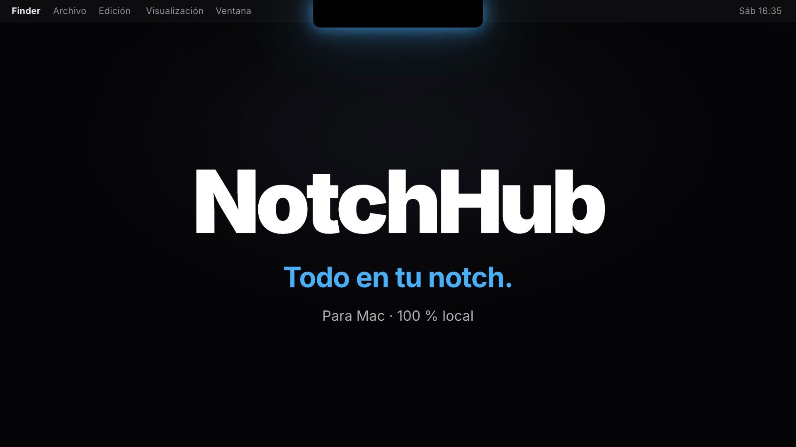
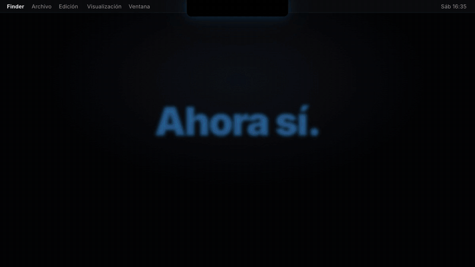
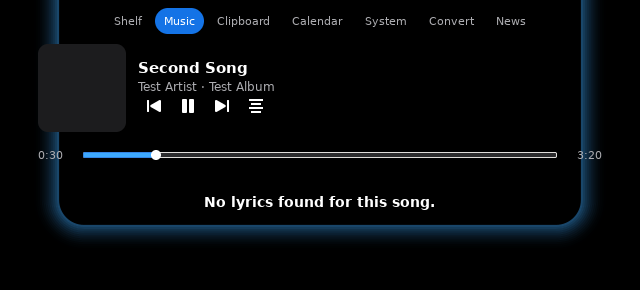
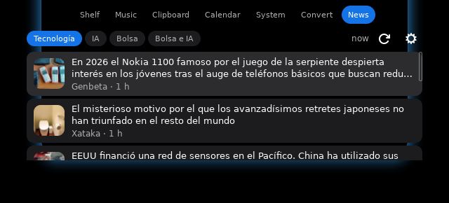
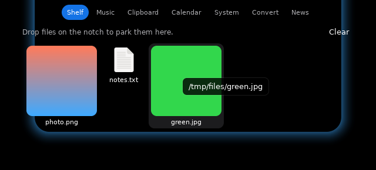
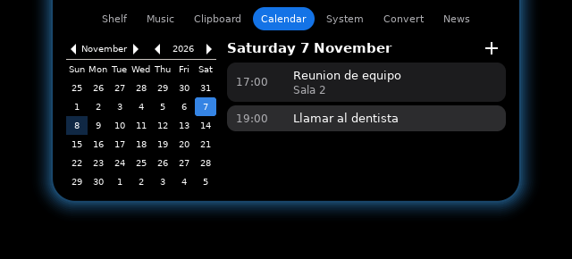

<div align="center">



# NotchHub

### Give your MacBook's notch a job.

A tiny, always-on app that turns the notch into a shelf, a music player, a clipboard, a calendar and more.<br>
**macOS** (native Swift) and **Linux** (Rust, `.deb`).<br>
Hover it. Drop a file on it. A pixel pet lives next to it.




[Watch the full 25 s demo](docs/demo.mp4)

</div>

---

## Install in 60 seconds

You need a Mac with macOS 14 or newer and the Xcode command line tools (`xcode-select --install`).

```bash
git clone https://github.com/ErDanieh/NotchHub.git
cd NotchHub
./Scripts/build-app.sh
```

That is all. The script builds the app, installs it in `~/Applications/NotchHub.app` and opens it.
Run it again any time to update: it replaces the old copy by itself.

Hover the notch (or the little ball on your other screens) and it opens. To start it with your Mac, use the menu bar icon, then **Launch at login**.

> Optional: `brew install ffmpeg` adds MP3 output to the converter.

## What it does

| | |
|---|---|
| **Shelf** | Drop files on the notch and pick them up anywhere. AirDrop card, image previews. Hold a file and hover a tab to switch to it. |
| **Music** | Apple Music, Spotify and YouTube / YouTube Music in Chrome. Play, pause, skip, a real progress bar you can drag. |
| **Lyrics** | Synced lyrics in the Music tab and, if you want, line by line under the closed notch. |
| **Halo** | A neon glow around the notch while music plays. Your colour, intensity and speed. Can pulse to the beat, or stay on all the time. |
| **Clipboard** | History of what you copied. Passwords from password managers are ignored. Pin items, copy them again. |
| **Calendar** | Today and the next days, month view, and a heads-up before each event. |
| **Mirror** | Your camera in the notch, resizable. The camera is only on while the tab is open. |
| **System** | CPU, memory, network, battery, disk and the apps using the most. Alerts when something spikes. |
| **Converter** | Images (JPG, PNG, HEIC...), PDF to images and back, audio and video. Plus an image **weight reducer**: type the size you want and it does the rest. |
| **News** | Headlines in Spanish by category (Tecnología, IA, Bolsa). Create your own categories and add any website or RSS feed to each one from the gear in the tab. |
| **Docker** | Start, stop and restart your containers. Only shows up if Docker is installed. |
| **Pets** | A pixel pet walks along the menu bar, sleeps, peeks out from under the notch and dances when music plays. Nine to choose from. |
| **Other screens** | A small ball on every screen without a notch. Hover it and the full panel opens there. |

Every tab can be reordered or hidden from the menu bar icon (**Reorder tabs...**).

## Pets

Clawd (an orange block critter), Cat, Ghost, Robot, Slime, Frog, Space invader, Penguin and Bunny.
Pick one in **Settings, Pet**, and choose its size.

## Permissions

NotchHub asks only for what a feature needs, when you use it:

| Permission | Used for |
|---|---|
| Automation (Music, Spotify, Chrome) | Reading and controlling playback |
| Calendars | The calendar tab and event alerts |
| Camera | The mirror tab |
| System Audio Recording | Only if you turn on "halo follows the beat". Nothing is recorded or saved |

For YouTube in Chrome, enable **View, Developer, Allow JavaScript from Apple Events**.

Everything runs on your Mac. No account, no analytics, no servers of ours. Lyrics come from [LRCLIB](https://lrclib.net) and news from public RSS feeds.

## Settings

Menu bar icon, then **Settings...** Halo colour and intensity, pulse speed, open delay, ball and pet options, alert types and thresholds, lyric timing, hide in full screen.

## Build and hack

```bash
swift build -c release        # compile only
./Scripts/build-app.sh        # build, sign, install, relaunch
```

Pure SwiftPM, no Xcode project. The code is in `Sources/NotchHub`: one file per feature (`Halo.swift`, `Lyrics.swift`, `Pets.swift`, `Converter.swift`...).
If you have an Apple Development certificate the script signs with it, so macOS keeps your permissions between builds. Otherwise it signs ad hoc.

The planning notes (feature map, architecture, build log) are in [`replica/`](replica).

## Credits

Inspired by NotchBox on the Mac App Store. This is an independent, from-scratch rewrite for personal use and shares no code or assets with it. Clawd-style pixel pets are original drawings.

---

## Linux (Ubuntu, Debian and friends)

The same idea, rewritten from scratch in **Rust** with GTK4. There is no notch on a Linux laptop, so NotchHub hangs a
small **pill under your top bar**. Hover it (or drop a file on it) and it opens.

<p align="center">
  
  
  
  
</p>

### Install

Download the `.deb` for your machine from the [Releases](../../releases) page (`amd64` for most PCs, `arm64` for
Raspberry Pi and Asahi) and install it:

```bash
sudo apt install ./notchhub_*.deb
notchhub
```

Or build it yourself (Rust and GTK4 development files needed):

```bash
sudo apt install build-essential pkg-config libgtk-4-dev libpulse-dev libpoppler-glib-dev libx11-dev ffmpeg
cd linux
cargo build --release
cargo install cargo-deb && cargo deb -p notchhub --no-build   # optional: makes the .deb
```

NotchHub starts with your session if you turn on **Start NotchHub when I log in** in its settings.
Open the settings from the tray icon, or just run `notchhub` again.

### What is the same, what changes

| | |
|---|---|
| **Shelf** | Drop files on the pill, drag them out again. Right click: open, show in folder, send to your phone with KDE Connect (if installed). Holding a file over a tab switches to it. |
| **Music** | Anything that speaks MPRIS: Spotify, YouTube and YouTube Music in the browser, VLC, Rhythmbox... Progress bar you can drag, synced lyrics (also under the closed pill), song alert. |
| **Halo** | Neon glow while music plays, or always. Colour, intensity, pulse speed, and an option to follow the beat of the system audio. |
| **Clipboard** | History with pins. Entries marked secret by password managers are ignored. |
| **Calendar** | Add an `.ics` file or the secret iCal address of your calendar (Google, Nextcloud, Outlook...). Month view, day agenda, heads-up before each event. |
| **System** | CPU, memory, network, battery, disk, busiest apps, and alerts when something runs hot. |
| **Convert** | Images, PDF to pictures, pictures to PDF, smaller PDF, audio and video (needs `ffmpeg`), and the **weight reducer**: say the size you want and it finds the best quality that fits. |
| **News** | Categories you create, with the sources you choose. Paste a website and it finds the feed. Defaults can be deleted and restored. |
| **Docker** | Start, stop and restart containers. Only shown when Docker is installed. |
| **Pets** | Nine pixel pets that hang from the top bar, wander, sleep, peek out from under the pill and dance to music. |
| **Other screens** | A small ball at the top of every other screen; hover it and the panel opens there. |
| Camera mirror, AirDrop | Not in the Linux version. |

### Good to know

- **GNOME on Wayland:** GNOME does not let apps place their own windows, so NotchHub runs through XWayland
  (it asks for X11 on its own). KDE, Xfce, Sway and X11 sessions work the same way.
- **Tray icon:** GNOME needs the *AppIndicator* extension to show it (Ubuntu has it on). Without it, run `notchhub`
  again to open the settings.
- **Beat-synced halo** listens to the monitor of your default output through PulseAudio / PipeWire. Nothing is recorded.
- Everything runs on your computer. No account, no telemetry. Lyrics come from [LRCLIB](https://lrclib.net) and news
  from the feeds you pick.

### Develop

The Linux code lives in [`linux/`](linux): `notchhub-core` (logic, with tests), `notchhub-mpris` (now playing) and
`notchhub` (the GTK app). A Docker image with every dependency, a virtual X server and a compositor lets you build and
see it from any machine, including a Mac:

```bash
docker build -t notchhub-linux linux
linux/dev.sh cargo test --workspace      # unit and integration tests
linux/dev.sh cargo build -p notchhub
```

---

<details>
<summary><b>Leer en español</b></summary>

**NotchHub** le da trabajo al notch de tu MacBook: estantería de archivos con AirDrop, música con letras y halo al ritmo, portapapeles, calendario, espejo, rendimiento, conversor de archivos, noticias, Docker y mascotas pixel art.

**Instalar** (macOS 14+ y las herramientas de línea de comandos de Xcode):

```bash
git clone https://github.com/ErDanieh/NotchHub.git
cd NotchHub
./Scripts/build-app.sh
```

Se instala en `~/Applications` y se abre solo. En **Linux** hay una versión en Rust con paquete `.deb` (mira la sección Linux). Pasa el ratón por el notch para abrirlo. Para que arranque con el Mac: icono de la barra de menús, **Launch at login**.

</details>
